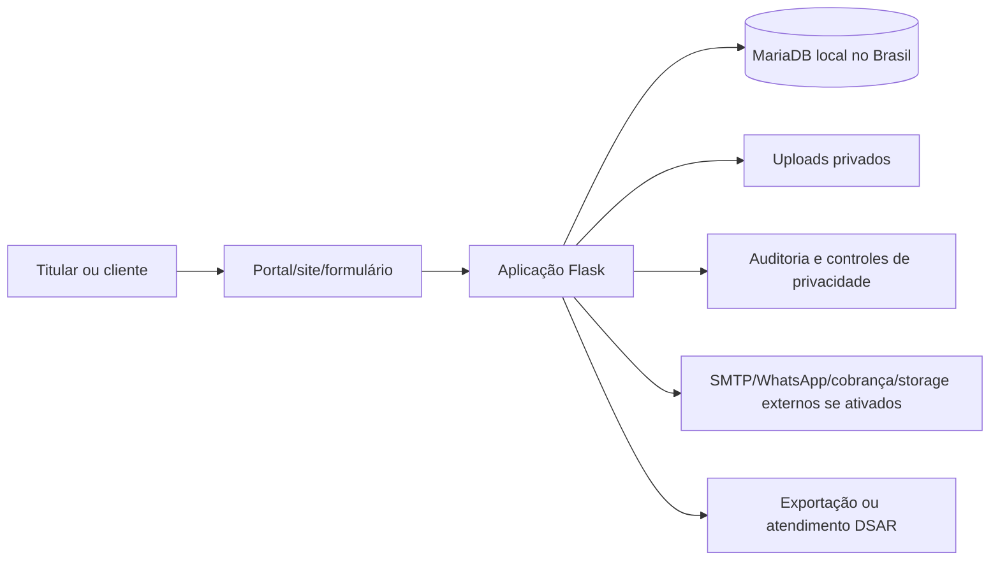

# RIPD — Portal, laudos e acesso possível por menores

**Atividade:** atendimento técnico, portal do cliente, laudos e sites públicos  
**Slug:** `portal-laudos-menores`  
**Controlador:** assistência correspondente para dados operacionais; Zokyo para dados próprios do SaaS  
**Encarregado:** pendente de designação  
**Equipe:** produto, engenharia, infraestrutura, assistência controladora e jurídico/encarregado  
**Versão:** v0.1 — rascunho técnico | **Data:** 06/11/2026

> Este RIPD usa a metodologia indicada pela skill `lgpd-ripd`: teste cumulativo de alto risco da Resolução CD/ANPD nº 2/2022, Art. 4º, princípios do Art. 6º, direitos do Art. 18, análise de risco baseada em ISO 31000/ISO 27005 e salvaguardas do Art. 46 da LGPD. Não é aprovação jurídica.

## 1. Sumário executivo

O sistema armazena dados de clientes, ordens de serviço, laudos, fotos, assinaturas, comunicações e informações financeiras para assistências técnicas. O portal e os sites publicados podem expor informações de atendimento ao titular mediante token ou autenticação.

O RIPD é necessário porque há possibilidade de dados sensíveis em texto livre e arquivos, acesso possível por crianças/adolescentes e potencial tratamento em escala ainda não mensurada. O resultado atual é **prosseguir somente com modificações e controles pendentes**, sem considerar o tratamento aprovado até revisão dos responsáveis.

## 2. Contexto

- **Produto:** SaaS multiempresa de assistência técnica, portal do cliente e publicação opcional de sites.
- **Stakeholders:** titulares, assistências controladoras, Zokyo operadora, usuários internos, provedores, encarregado e autoridade.
- **Volume estimado:** não informado; deve ser medido por assistência e agregado antes da decisão final.
- **Início:** tratamento existente no legado; mudanças contínuas.
- **Fator de menores:** o responsável informou que o sistema pode ser acessado por menores.
- **Inventário de pontos de entrada:** ver a matriz por rota em `.lgpd/eca-digital.md`; ela separa site estático enviado por assistência, consulta pública de OS, portal de orçamento, API de cliente, canal DSAR e painel interno. O enquadramento ECA e o tratamento de acesso por menores devem ser aprovados por fluxo.

## 3. Descrição do tratamento

### 3.1 Fluxo de dados

### 3.2 Sistemas envolvidos

- Aplicação Flask e templates HTML.
- MariaDB e Redis no servidor local informado no Brasil.
- Storage local de uploads; S3 compatível opcional.
- Logs `EventoLog`, auditoria hash-encadeada, solicitações e incidentes.
- SMTP, Asaas, Meta, Cloudflare e Sentry somente quando ativados e aprovados.

### 3.3 Operadores

As fichas estão em `.lgpd/vendors/`. O servidor local foi informado como Brasil; país, suboperadores, DPA e transferência dos serviços externos permanecem pendentes.

## 4. Necessidade e proporcionalidade

- Dados de identificação e contato são necessários para localizar o cliente e prestar atendimento.
- OS, laudos e evidências são necessários para executar e comprovar o serviço, mas campos livres devem ser minimizados.
- Fotos, assinaturas e documentos devem ser coletados somente quando necessários à finalidade específica.
- O portal deve exibir o mínimo necessário e não deve permitir acesso por URL previsível ou token reutilizável sem expiração.
- Não há justificativa para publicidade comportamental ou perfilização de menores; esse uso deve ser bloqueado.
- Alternativa de menor risco: limitar dados públicos, separar dados internos, aplicar tokens expirados, exportar apenas mediante validação e manter storage privado.

## 5. Princípios LGPD — Art. 6º

| Princípio | Estado atual e requisito |
|---|---|
| Finalidade | Mapear por atividade no ROPA e contrato da assistência. |
| Adequação | Portal e site devem mostrar somente o que corresponde ao atendimento. |
| Necessidade | Revisar texto livre, fotos, documentos e campos obrigatórios. |
| Livre acesso | Canal `/privacidade/solicitacao` e triagem administrativa implementados; atendimento completo pendente. |
| Qualidade | Permitir correção mediante validação e registrar a decisão. |
| Transparência | Política em rascunho; falta preencher dados institucionais e publicar após revisão. |
| Segurança | RBAC, isolamento, proteção de senha e auditoria existem; chaves, backups e testes operacionais precisam de evidência. |
| Prevenção | Runbook de incidente, registro e checklist RIPD criados; simulação pendente. |
| Não discriminação | Não usar dados de menores para perfilização ou publicidade. |
| Responsabilização | ROPA, DPA, logs, decisões e aprovações precisam ser mantidos versionados. |

## 6. Bases legais preliminares

- Assistência: execução de contrato, exercício regular de direitos e obrigação legal conforme o atendimento.
- Zokyo: execução do contrato SaaS, segurança, suporte e obrigações próprias conforme a finalidade.
- Dados sensíveis eventualmente presentes: classificar caso a caso e validar Art. 11; não presumir consentimento.
- Marketing: finalidade separada, com base e descadastro próprios.
- Crianças e adolescentes: aplicar LGPD Art. 14 e Lei nº 15.211/2025 conforme o fluxo e orientação jurídica.

## 7. Direitos do titular

| Direito | Controle atual ou pendência |
|---|---|
| Confirmação e acesso | Canal público criado; resposta e identidade ainda precisam de procedimento operacional. |
| Correção | Deve ser atendida pela assistência controladora e registrada na solicitação. |
| Anonimização/bloqueio/eliminação | Serviço administrativo existe, mas bloqueia quando há retenção; ampliar para arquivos e dependências. |
| Portabilidade | Exportação JSON/ZIP existe; incluir artefatos pertinentes após validação. |
| Informação sobre compartilhamento | ROPA e política devem listar operadores ativos. |
| Revogação | Ledger de consentimento existe para finalidades específicas; comunicar consequência e registrar. |
| Revisão de decisões automatizadas | Não há decisão automatizada identificada; manter esse escopo documentado. |

## 8. Riscos — ISO 31000 / ISO 27005

| ID | Risco | P | I | Nível | Mitigação | Status | Residual |
|---|---|---:|---:|---:|---|---|---:|
| R001 | Exposição de laudo, foto ou assinatura no portal | 3 | 5 | 15 | ACL privada, tokens expiráveis, autorização por tenant e logs | pendente de evidência completa | 8 |
| R002 | Acesso indevido por funcionário ou super admin | 3 | 5 | 15 | menor privilégio, acesso justificado, MFA, auditoria e revisão | parcial | 8 |
| R003 | Texto livre conter dado sensível desnecessário | 4 | 4 | 16 | minimização, avisos, classificação e treinamento | pendente | 9 |
| R004 | Tratamento indevido de menor | 3 | 5 | 15 | idade/responsável, controles parentais, antiperfilização e ECA | pendente | 8 |
| R005 | Transferência a provedor externo sem salvaguarda | 2 | 5 | 10 | inventário, DPA, país e bloqueio antes da ativação | parcial | 5 |
| R006 | Perda ou corrupção de dados | 2 | 5 | 10 | backups criptografados, manifesto, restore e monitoramento | parcial | 5 |
| R007 | Incidente sem comunicação ou registro suficiente | 2 | 5 | 10 | runbook, registro, decisão documentada e simulação | parcial | 5 |

## 9. Salvaguardas técnicas

- [x] Isolamento por organização e controle por função.
- [x] Senhas protegidas, CSRF, rate limit e autenticação adicional disponível.
- [x] Canal de solicitação, registro de incidentes e auditoria com hash.
- [ ] Verificar TLS e configuração real do proxy em produção.
- [ ] Formalizar rotação e armazenamento das chaves de criptografia.
- [ ] Garantir ACL privada e ciclo de vida de todos os uploads.
- [ ] Executar backup criptografado e restore em ambiente descartável.
- [ ] Testar pentest, revisão de privilégios e simulação de incidente.
- [ ] Implementar as salvaguardas específicas para menores antes da expansão do acesso público.

## 10. Salvaguardas administrativas

- [ ] Designar encarregado e publicar canal.
- [ ] Aprovar ROPA, bases legais, retenção e política.
- [ ] Formalizar DPA com assistências e operadores.
- [ ] Treinar equipe e manter evidência de aceite.
- [ ] Definir responsáveis e SLA de incidente.
- [ ] Realizar consulta com assistência, titulares quando possível, segurança e jurídico.

## 11. Consulta a partes interessadas

- Assistências controladoras: pendente.
- Titulares: pesquisa não realizada.
- Encarregado: pendente de designação.
- Jurídico: revisão pendente.
- Segurança/infraestrutura: revisão técnica inicial realizada; evidências operacionais pendentes.

## 12. Decisão

- [ ] Prosseguir como planejado.
- [x] Prosseguir somente com modificações listadas neste documento.
- [ ] Não prosseguir.
- [ ] Consultar a ANPD previamente.

**Aprovado por:** pendente.  
**Data:** pendente.

## 13. Plano de revisão

Revisar antes da publicação da política, antes de habilitar novos provedores, após incidente, mudança de finalidade, inclusão de dados sensíveis/menores ou alteração relevante do portal. Revisão máxima sugerida: seis meses.
